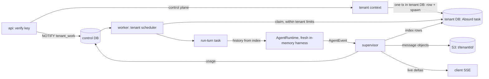

# Architecture

Kerby is an agent runtime sold as a service. Customers (tenants) call it over HTTP; it runs their agents durably,
calls the tools they register, and keeps every transcript. Postgres is the only service it needs (plus S3-compatible
storage for bytes). Why: ADRs [0001](docs/adr/0001-platform-and-tenancy.md),
[0002](docs/adr/0002-postgres-absurd-s3.md), [0003](docs/adr/0003-harness-agnostic-runtime.md),
[0004](docs/adr/0004-database-per-tenant.md), [0005](docs/adr/0005-dependencies.md) (dependency list).

```
scripts/    occasional tooling and repo checks; not product
packages/   libraries, imported as @kerby/<dir>
services/   deployables: api (tenants call it), worker (runs turns), control (operators run it); each owns its tables
docs/       what an agent must know that the code does not say
```

Every rule below is enforced by `make architecture` ([scripts/check-architecture.ts](scripts/check-architecture.ts))
unless marked _review_. A failure message names the fix. Fix the code; changing a rule needs an ADR.

## Workspaces

- A workspace is `packages/<dir>` or `services/<dir>`, named `@kerby/<dir>`; `<dir>` is unique across both.
- `scripts` and `services` import packages. Packages import packages. **A service is never imported**:
  services meet over HTTP, with the schemas in `packages/contracts`.
- A relative import never leaves its workspace.
- No build step: `exports` points at `src/index.ts` and Node runs TypeScript directly (`erasableSyntaxOnly`).

## Layers

Inside a service, `src/` holds `index.ts` and these directories. A layer imports itself and layers to its left.

```
types -> config -> repo -> service -> runtime
```

| Layer     | Holds                                                                                                  |
| --------- | ------------------------------------------------------------------------------------------------------ |
| `types`   | Types and schemas local to the service.                                                                |
| `config`  | The service's config schema (read once, validated at start).                                           |
| `repo`    | SQL. The only layer that touches a database, always through a `ControlDb` or `TenantDb` argument.      |
| `service` | Business logic. Takes ports (`AgentRuntime`, blobs) and a tenant context as arguments.                 |
| `runtime` | HTTP routes and Absurd task handlers. Authenticates, builds the tenant context, wires layers together. |

`src/index.ts` is the composition root: it builds the real adapters and hands them down. Tests may import any layer.

## Providers

Each external system lives behind exactly one package; nothing else imports the SDK.

| System                       | Only `packages/...`  | Package offers                                                              |
| ---------------------------- | -------------------- | --------------------------------------------------------------------------- |
| Postgres (`pg`)              | `db`                 | `ControlDb`, `TenantDb`, the tenant pool registry, migrations (both planes) |
| Absurd (`absurd-sdk`)        | `durable`            | task names and params, spawn, register, the tenant scheduler's claim loop   |
| S3 (`@aws-sdk/client-s3`)    | `blobs`              | `put` / `get` taking a tenant context, writing the tenant's blob index      |
| Pi Durable and its libraries | `runtime-pi-durable` | an `AgentRuntime`                                                           |

An agent harness is replaceable by construction: `packages/agent` defines `AgentRuntime` and `AgentEvent`;
`packages/runtime-<harness>` adapts one harness to it; only a service's `src/index.ts` may import an adapter.

## Tenancy

A tenant is an untrusted customer. Isolation is structural: a database per tenant, a key prefix per tenant.

| Plane   | Database                                             | Holds                                                                                                      | Migrations            |
| ------- | ---------------------------------------------------- | ---------------------------------------------------------------------------------------------------------- | --------------------- |
| Control | one, operator-owned                                  | `tenants` (status, plan, limits, region, locators), `api_keys`, encrypted `tenant_secrets`, `usage`, audit | `migrations/control/` |
| Tenant  | one per tenant, on a cluster the control plane names | conversations, messages, blob index, tool registrations, the Absurd schema                                 | `migrations/tenant/`  |

- Every `.sql` migration lives in one of those two directories. A control table has `tenant_id` or `-- global: <reason>`
  on the line above `create table`. A tenant table needs no tenant column: the database is the boundary.
- `packages/db` exports `ControlDb` and `TenantDb` as distinct types. Repo functions take one, never a pool or DSN. A
  `TenantDb` comes only from a verified API key resolved in the control plane.
- A tenant id reaches code only through that verified key, never through a request body. _review_
- `AgentRuntime` never sees a tenant, user, or conversation id; Kerby's closures carry them.
- Object keys start with `t/<tenantId>/`; `packages/blobs` takes a tenant context on every call.
- Tenant model keys and tool credentials are encrypted in the control plane and decrypted only inside a run. Logs carry the
  tenant id, never message content or secrets. _review_
- No tenant code runs in Kerby's processes. Tools are remote MCP servers reached through an egress guard (no private
  ranges, no redirects into them). _review_
- Lifecycle is an operator command in `services/control`: provision, suspend, export, delete.

## Durability: the turn lifecycle

The harness is disposable. Kerby owns durability by persisting what the harness reports, in the tenant's own database and prefix.



1. **Schedule.** The worker learns of work from the control plane's `NOTIFY` (a periodic sweep catches missed ones) and
   claims from that tenant's database only while the tenant is under its concurrency limit.
2. **Rehydrate.** The task reads the conversation's messages from the tenant's index (bodies from S3) and starts a
   fresh in-memory harness with them as `AgentRun.history`. Workers hold no state, so any worker takes any turn. A tool
   call in the history without a persisted result is resolved first through `executeTool` (a cached step), never left to the harness.
3. **Run.** The adapter turns the harness's native events into `AgentEvent`s. That mapping is the only
   harness-specific transformation; everything downstream sees one format. The supervisor heartbeats the Absurd lease
   for as long as the run lasts, including a model call that writes no checkpoint.
4. **Persist before act.** The supervisor writes each `message_end` (an S3 object under a deterministic key, then an index
   row, then an Absurd step) before the next event is pulled. A tool runs only after the message that requested it is persisted.
   The index insert is **fenced**: it succeeds only while this run is still the task's latest (`last_attempt_run`), under a
   row lock on the task, and `(conversation, seq)` is unique. A worker whose lease lapsed cannot write a divergent message.
5. **Tools run once.** `AgentRun.executeTool` is an Absurd step keyed by conversation and tool-call id: a retry gets the
   stored result instead of repeating a side effect.
6. **Retry** is a rerun of step 2 onward. The conversation resumes after its last persisted message.

Source of truth for a conversation is the tenant's index plus S3, never Absurd checkpoints: Absurd's retention
cleanup may delete those. Checkpoint values stay small JSON (references, not bodies).

## Configuration

- A service declares a zod schema in `src/config/` and calls `loadConfig` from `@kerby/config` once, in `src/index.ts`.
  Sources, lowest to highest: a YAML file (`KERBY_CONFIG_FILE`), environment variables, a secrets directory
  (`KERBY_SECRETS_DIR`, one file per secret). A key `databaseUrl` is `DATABASE_URL` in the environment.
- Failure lists every bad key and never a value. Unknown keys in the file fail.
- Only `packages/config` and `scripts/` read the process environment. Enforced (rule `config`).

## Dependencies

- One version of everything, in the `catalog:` of `pnpm-workspace.yaml`, exact pins. Workspaces say `"catalog:"`;
  `@kerby/*` say `"workspace:*"`. An import must be declared by its workspace.
- A new dependency is a catalog line plus an ADR line (what, why, alternatives).
- pnpm refuses versions younger than 7 days (`minimumReleaseAge`). Pick the newest older one; leave the setting.
- Node version: `.node-version`. pnpm: `packageManager` in `package.json`.
