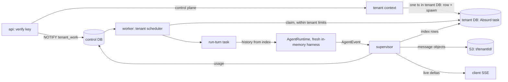

# Architecture

Kerby is a self-hosted agent runtime: one install per project, run beside it in Docker Compose or inside its Railway
project, serving one tenant, its owner ([ADR 0024](docs/adr/0024-self-hosted-single-tenant.md)). Applications call it
over HTTP; it runs their agents durably, calls the tools they register, and keeps every transcript. Postgres is the only
service it needs (plus S3-compatible storage for bytes). It keeps the tenancy boundary of the multi-tenant service it
started as, so selling it as one later is a plan, not a rewrite. Why: ADRs [0001](docs/adr/0001-platform-and-tenancy.md),
[0002](docs/adr/0002-postgres-absurd-s3.md), [0003](docs/adr/0003-harness-agnostic-runtime.md),
[0004](docs/adr/0004-database-per-tenant.md), [0005](docs/adr/0005-dependencies.md) (dependency list), [0006](docs/adr/0006-schema-lives-in-packages.md), [0014](docs/adr/0014-tenant-console.md), [0015](docs/adr/0015-judgment-port.md), [0016](docs/adr/0016-guardrails.md), [0017](docs/adr/0017-prompts.md), [0018](docs/adr/0018-trace.md), [0019](docs/adr/0019-events-and-delivery.md), [0020](docs/adr/0020-integrations-and-scopes.md), [0021](docs/adr/0021-chat-search.md), [0022](docs/adr/0022-tools.md), [0023](docs/adr/0023-sdk.md), [0024](docs/adr/0024-self-hosted-single-tenant.md).

```
scripts/    occasional tooling and repo checks; not product
packages/   libraries, imported as @kerby/<dir>
services/   deployables: api (applications call it), worker (runs turns), dispatcher (pushes events to subscriptions),
           control (prepares the databases and the install's tenant), kerby (the launcher: runs those four in one
           container), console (the owner manages integrations and tools, and chats in it); they own no tables
docs/       what an agent must know that the code does not say
```

Every rule below is enforced by `make architecture` ([scripts/check-architecture.ts](scripts/check-architecture.ts))
unless marked _review_. A failure message names the fix. Fix the code; changing a rule needs an ADR. Docs are checked
by `make docs` ([scripts/check-docs.ts](scripts/check-docs.ts)): relative links resolve, and every `make` target and
rule a doc names exists. `make knip` ([knip.jsonc](knip.jsonc)) fails on dead files, exports no workspace imports
(package entry files included), and unused or undeclared dependencies: delete them, or tag a deliberate keep `@public`
with the reason.

## Workspaces

- A workspace is `packages/<dir>` or `services/<dir>`, named `@kerby/<dir>`; `<dir>` is unique across both.
- `scripts` and `services` import packages. Packages import packages. **A service is never imported**:
  services meet over HTTP, with the schemas in `packages/contracts`.
- A relative import never leaves its workspace.
- No build step: `exports` points at `src/index.ts` and Node runs TypeScript directly (`erasableSyntaxOnly`). The one
  exception is the console's pages, which `next build` compiles when its image is built (ADR 0014).
- `packages/sdk` is the one package that leaves the repository: applications install it. `make sdk-build` compiles it
  with the contract files it re-exports (`@kerby/contracts/tenant`); CI runs `make sdk-publish` on every merge to `main`, which pushes the result to a private
  repository as a tag ([ADR 0023](docs/adr/0023-sdk.md)). Its `INTEGRATION.md` is the guide an agent follows to integrate
  an application; a change to a tenant-facing contract or route is a change to the SDK and that guide, and `make sdk-e2e` shows it.

## Layers

Inside a service, `src/` holds `index.ts` and these directories. A layer imports itself and layers to its left.

```
types -> config -> repo -> service -> runtime
```

| Layer     | Holds                                                                                                  |
| --------- | ------------------------------------------------------------------------------------------------------ |
| `types`   | Types and schemas local to the service.                                                                |
| `config`  | The service's config schema (read once, validated at start).                                           |
| `repo`    | SQL. The only layer that touches a database, always through a `ControlDb` or `TenantDb` argument.      |
| `service` | Business logic. Takes ports (`AgentRuntime`, blobs) and a tenant context as arguments.                 |
| `runtime` | HTTP routes and Absurd task handlers. Authenticates, builds the tenant context, wires layers together. |

`src/index.ts` is the composition root: it builds the real adapters and hands them down. Tests may import any layer.

SQL compares a uuid column as uuid (`id = $1`), after checking the value with `isUuid` from `@kerby/db` (anything else is
not found); a column cast to text matches no index, so every call would scan the table (enforced, rule `queries`).

A service built on Next.js (the console) keeps its pages and server actions in `src/app`, where Next.js looks for them:
that is its `runtime` layer. Next.js bundles `src/app`, so it imports Kerby packages and the rest of `src/` with
`import type` only, and reaches values through what `src/index.ts` installed (`consoleService()`); otherwise the bundle
would hold second copies of packages the composition root already built (enforced, rule `layers`; ADR 0014).

## Providers

Each external system lives behind exactly one package; nothing else imports the SDK.

| System                               | Only `packages/...`  | Package offers                                                                                                                       |
| ------------------------------------ | -------------------- | ------------------------------------------------------------------------------------------------------------------------------------ |
| Postgres (`pg`)                      | `db`                 | `ControlDb`, `TenantDb`, the tenant pool registry, migrations (both planes)                                                          |
| Absurd (`absurd-sdk`)                | `durable`            | task names and params, spawn, register, the tenant scheduler's claim loop                                                            |
| S3 (`@aws-sdk/client-s3`)            | `blobs`              | `put`/`get`/`delete` by tenant context; raw-key `Bucket` for control only                                                            |
| Pi Durable and its libraries         | `runtime-pi-durable` | an `AgentRuntime`                                                                                                                    |
| Tenant-supplied URLs                 | `egress`             | a `fetch` that reaches only public addresses (ADR 0010)                                                                              |
| System One API (TypeSafe, OpenCode)  | `judgment-systemone` | a `JudgmentProvider` (ADR 0015); the port is `packages/judgment`                                                                     |
| Webhook endpoints (via `egress`)     | `delivery-webhook`   | a `Destination` (ADR 0019); the port is `packages/delivery`                                                                          |
| OpenAI-format embeddings APIs        | `embeddings-openai`  | an `EmbeddingProvider` (ADR 0021); the port is `packages/embeddings`                                                                 |
| Remote MCP servers (Streamable HTTP) | `mcp`                | an `McpSession` (list and call tools) over the `fetch` it is given, always the egress guard's (ADR 0022); written on `fetch`, no SDK |

An agent harness is replaceable by construction: `packages/agent` defines `AgentRuntime` and `AgentEvent`;
`packages/runtime-<harness>` adapts one harness to it; only a service's `src/index.ts` may import an adapter.
Judgment and embedding providers follow the same rule: `packages/judgment` and `packages/embeddings` define
`JudgmentProvider` and `EmbeddingProvider` (types only, plus the embeddings fake at `@kerby/embeddings/fake`),
`packages/judgment-<provider>` and `packages/embeddings-<wire format>` adapt providers to them, and only a service's
`src/index.ts` may import an adapter. So do event destinations: `packages/delivery` defines `Destination` (types only),
`packages/delivery-<kind>` delivers to one kind, and the composition roots of api (which only makes and checks secrets
and configs) and dispatcher wire them.

## Tenancy

An install has exactly one tenant ([ADR 0024](docs/adr/0024-self-hosted-single-tenant.md)), but the code keeps the
boundary a multi-tenant service needs, so a SaaS return is a plan and not a rewrite: isolation is structural, a database
per tenant and a key prefix per tenant, and a tenant is treated as untrusted.

| Plane   | Database                                             | Holds                                                                                                                                                                                                                                                                                                                                                                                           | Migrations                                                                              |
| ------- | ---------------------------------------------------- | ----------------------------------------------------------------------------------------------------------------------------------------------------------------------------------------------------------------------------------------------------------------------------------------------------------------------------------------------------------------------------------------------- | --------------------------------------------------------------------------------------- |
| Control | one per install                                      | `tenants` (status, plan, limits, region, locators), `integrations`, `api_keys`, event `subscriptions` (signing secret sealed), encrypted `tenant_secrets` (model keys, tool credentials), sealed `tenant_db_credentials`, `usage`, audit, `tenant_wakeups` (when each tenant's queue is due), the console's `console_users` and `console_sessions`                                              | `packages/control-plane/migrations/control/`                                            |
| Tenant  | one per tenant, on a cluster the control plane names | conversations, messages, trace segments, blob index, prompts (`prompts`, `prompt_versions`, `prompt_labels`), the event log (`events`, `subscription_cursors`, `delivery_attempts`), the chat search index (`search_chunks`, `search_progress`, `search_settings`; pgvector), tools (`tool_servers`, `tools`, `integration_tools`, `conversation_tools`, `tool_oauth_flows`), the Absurd schema | `packages/{durable,blobs,conversations,prompts,events,search,tools}/migrations/tenant/` |

- Every `.sql` migration lives in a `migrations/control/` or `migrations/tenant/` directory of the package that owns the tables (ADR 0006). A control table has `tenant_id` or `-- global: <reason>`
  on the line above `create table`. A tenant table needs no tenant column: the database is the boundary.
- `packages/db` exports `ControlDb` and `TenantDb` as distinct types. Repo functions take one, never a pool or DSN. A
  `TenantDb` comes only from a verified API key resolved in the control plane.
- A tenant id reaches code only through a verified API key (api), a verified console session (console, and the api when the
  console forwards one for the browser's chat), never through a request body or a URL. _review_
- An API key belongs to an integration ([ADR 0020](docs/adr/0020-integrations-and-scopes.md)), which holds its scopes
  (`conversations`, `judgments`, `events`, `tenant`, `admin`); every api route declares the scope it needs. Without
  `tenant`, a key sees only what its integration started: conversation, judgment and event reads take a `Visibility`, so
  none can forget the filter. A console session acts as the tenant, with every scope.
- Tools layer on those integrations ([ADR 0022](docs/adr/0022-tools.md)): an integration holding `admin` (and a console
  session) may use every enabled tool; any other only the tools granted to it (`integration_tools`, tenant database,
  keyed by the integration's id). Tool-server and grant routes need `admin`; `GET /v1/tools` needs `conversations`.
- `AgentRuntime` never sees a tenant, user, or conversation id; Kerby's closures carry them.
- Object keys start with `t/<tenantId>/`; `packages/blobs` takes a tenant context on every call from api and worker
  (`Blobs`). Only `control` uses its raw-key `Bucket`: it creates the bucket and deletes a tenant's prefix.
- Tenants bring their own model keys ([ADR 0008](docs/adr/0008-byok-sealed-secrets.md)), for chat and judgment providers alike; Kerby holds no provider key. A key is
  sealed by `packages/secrets` to a public key the api and the console hold, stored in the control plane's `tenant_secrets`, and
  opened only by a worker (the private key) inside the run that uses it. A tool server's credential takes the same path
  (`tool-credential/<serverId>`, ADR 0022). Logs carry the
  tenant id, never message content or secrets; the worker scrubs the key from provider errors. _review_
- No tenant code runs in Kerby's processes. Tools are remote MCP servers. Every call to a URL a tenant supplied goes
  through `createEgressFetch` from `packages/egress` ([ADR 0010](docs/adr/0010-egress-guard.md)): public addresses
  only, connected to the address it checked, redirects re-checked, time and size limits. An install may name its own
  private hosts the guard lets through anyway (`EGRESS_ALLOWED_HOSTS`), and let webhooks reach private addresses
  (`ALLOW_LOCAL_DESTINATIONS`): the tenant is the owner (ADR 0024). _review_
- The install's tenant is control's to keep (ADR 0024). At every start control migrates the control database, the
  template and every tenant database, then makes the tenant if there is none (`KERBY_TENANT_NAME`), refuses to start if
  there are two, and removes one a start left half made. Provisioning copies the template database and creates a role
  that owns that database and may connect to no other tenant database, with a random password of its own
  ([ADR 0009](docs/adr/0009-tenant-database-credentials.md)): stored in `tenant_db_credentials` sealed by
  `packages/secrets` under `TENANT_DB_KEYS` (tenant id as authenticated data), which control, api, worker and dispatcher
  hold. `TenantPools` resolves a tenant's URL from it and its pools look the password up again at every login. At
  startup control also gives a password to every tenant lacking one, re-seals those under an older key, and closes the
  maintenance databases (`postgres`, `template1`) and the template to everyone but its admin role, as it does the control
  database: a tenant role can open its own database and nothing else.
- Config is the source of the tenant's first credentials. `KERBY_API_KEY` is kept live on the `default` integration with
  every scope (label `KERBY_API_KEY`; the one configured before it is revoked). `KERBY_ADMIN_EMAIL` and
  `KERBY_ADMIN_PASSWORD` are the console's one account (`console_users`), hashed by `hashPassword` in
  `packages/control-plane`; a changed password replaces the hash, a changed email replaces the account and its sessions.
  There is no sign-up. A console session is a random token in an HttpOnly cookie (Secure unless `SECURE_COOKIES=false`),
  kept as its SHA-256 (`console_sessions`, 7 days); it stops at once when the tenant is not active. The console connects
  as `kerby_console`: integrations and their API keys (never the hashes), model keys, people and sessions, appending to
  the audit log as `user:<id>`. Before sign-in it bounds failed sign-ins per client address (a minute) and per account
  (an hour), per process; sign-ins to one account take turns and an address checks four at once, each looking at the
  limits when its turn comes, so a concurrent burst cannot outrun them. A tenant holds at most 50 live API keys
  (`MAX_API_KEYS_PER_TENANT`, a message in the console); rotating a key at the cap works.
- Limits live in the tenant row (`limits`, [`LimitsSchema`](packages/contracts/src/install.ts), empty unless set by SQL);
  an absent key takes the service's default. `requestsPerMinute` (api `DEFAULT_REQUESTS_PER_MINUTE`, 600) is a token
  bucket per tenant **per api process**, so it is approximate: N processes allow up to N times it; past it a request is
  429 `rate_limited` with `Retry-After`. `storageBytes` (api `DEFAULT_STORAGE_BYTES`, 1 GiB) is checked against
  the tenant's stored bytes, `sum(size)` of its blob index plus its prompt drafts and versions (`storedBytes` in
  `packages/prompts`), when a message is posted, before anything is stored and again inside the post's transaction, and
  when a prompt's draft grows or it is published: 413 `storage_quota_exceeded`; a turn already admitted finishes.
  Before a key is verified, the only work is the key lookup: a client address that fails `FAILED_AUTH_PER_MINUTE` (30)
  times in a minute gets 429 without one. Lookups from one address take turns, four at once
  (`LOOKUPS_PER_ADDRESS`), each checking the limit when its turn comes and counting a wrong key before giving its turn
  up, so a concurrent burst of bad keys gets at most three lookups past the limit while many good keys at once only
  wait; a credential the cache answers, or one already being looked up for another request, needs no lookup. The cache keeps at most 10,000
  credentials (`MAX_CACHED_CREDENTIALS`), least recently used first, each for `AUTH_CACHE_SECONDS`. The
  address is the socket peer, or with `TRUST_PROXY=true` (behind Railway's edge, which sets `X-Forwarded-For` with the
  client first) the left-most `X-Forwarded-For` entry.

## Durability: the turn lifecycle

The harness is disposable. Kerby owns durability by persisting what the harness reports, in the tenant's own database and prefix.



1. **Schedule.** The worker learns of work from the control plane's `NOTIFY` and from `tenant_wakeups`: after enqueueing,
   the api marks the tenant due and then sends the `NOTIFY` (two statements, never one transaction); after each claim,
   the worker writes when that tenant's queue next needs a look (now for work left over, a retry's backoff, a lease that
   lapses; nothing when the queue is empty), unless a newer hint arrived meanwhile. Every `SWEEP_INTERVAL_SECONDS` (10)
   it looks at the tenants that are due; every `FULL_SWEEP_INTERVAL_SECONDS` (300), at start and when its `LISTEN`
   reconnects, at every active tenant, the backstop for a hint lost between the api's commit and its write. It
   claims from that tenant's database only while the tenant is under its concurrency limit, counted across every
   worker: the claim runs in a tenant-database transaction holding an advisory lock, counts the turns running there
   under a live lease and claims at most the difference. A worker already at the limit by itself does not ask. A worker
   also caps its running turns across all tenants (`MAX_RUNNING_TURNS`, default 50), which bounds its tenant
   connection pools: it reserves slots before a claim and never claims more than it can run, and a tenant that asks
   while the worker is full waits its turn (longest-waiting first), so a busy tenant cannot hold the slots against others.
   The same rules run in a lane per Absurd queue, each with its own limits: `turns` (above), `index` (one per tenant,
   `MAX_RUNNING_INDEX_TASKS`) and `search` (four per tenant, `MAX_RUNNING_SEARCHES`), so search work never takes a turn's slot.
2. **Rehydrate.** The task reads the conversation's messages from the tenant's index (bodies from S3) and starts a
   fresh in-memory harness with them as `AgentRun.history`. Workers hold no state, so any worker takes any turn. A tool
   call in the history without a persisted result is resolved first through `executeTool` (a cached step), never left to the harness.
   The history has a byte budget (`HISTORY_BUDGET_BYTES`, default 8 MiB): the worker walks the index newest first using
   the blob index's sizes, fetches only what fits, and cuts only before a user message, so the history starts a turn and
   a tool call never loses its result. Older turns past the budget are left out (logged with counts, never content); the
   turn being answered is always whole. Nothing is deleted: the index keeps every message.
3. **Run.** The adapter turns the harness's native events into `AgentEvent`s. That mapping is the only
   harness-specific transformation; everything downstream sees one format. The supervisor heartbeats the Absurd lease
   for as long as the run lasts, including a model call that writes no checkpoint.
4. **Persist before act.** The supervisor writes each `message_end` (an S3 object under a deterministic key, then an index
   row, then an Absurd step) before the next event is pulled. A tool runs only after the message that requested it is persisted.
   The index insert is **fenced**: it succeeds only while this run is still the task's latest (`last_attempt_run`), under a
   row lock on the task, and `(conversation, seq)` is unique. A worker whose lease lapsed cannot write a divergent message.
   Alongside it the supervisor records the run's complete events in the trace ([ADR 0018](docs/adr/0018-trace.md)); resume
   never reads it (see **Trace** below).
5. **Tools run once.** `AgentRun.executeTool` is an Absurd step keyed by conversation and tool-call id: a retry gets the
   stored result instead of repeating a side effect. A step that finds the call already began in an earlier attempt
   (`tool_executions` counts runs) runs it again only for a `read` tool; a `write` tool answers that it was interrupted
   and may or may not have taken effect (ADR 0022).
6. **Retry** is a rerun of step 2 onward. The conversation resumes after its last persisted message.

- **One turn at a time per conversation.** Posting a message while a turn is queued or running is a 409; the check and the
  insert share a row lock on the conversation, so concurrent posts serialize. A turn whose outcome event is recorded
  counts as finished, though its task is still closing: nothing is written after the outcome (ADR 0019).
- **Object keys carry a content hash** (`conversations/<id>/messages/<seq>-<sha16>.json`): a retry of the same message
  overwrites itself, and a stale writer's different content lands under a different key and can never replace bytes an
  index row already points at.
- **Paged reads.** `GET /v1/conversations/:id?after=<seq>&limit=<n>` returns one page (default 100, at most 500) and
  `nextAfter`, null on the last page. A conversation still holds at most 2000 messages and 64 MiB: those bound storage,
  not memory.
- **Browsing.** `GET /v1/conversations?limit=<n>&cursor=<c>&externalUserId=<id>` lists the tenant's conversations, most
  recently active first (`updated_at`, written by both message writers), with title and message count; `nextCursor` holds the
  last row's `updated_at` to the microsecond and its id. The console's chat uses it and the rest of this API with the person's
  session token ([ADR 0014](docs/adr/0014-tenant-console.md#amendment-chat-and-browsing-in-the-console-2026-11-22)).
- **Streaming.** `GET .../events` replays persisted messages from the index after `Last-Event-ID` (the message `seq`), a page at a time,
  then tails the tenant database with `LISTEN`: the api and the worker `NOTIFY` `{persisted: seq}` once a message has
  committed, and the worker sends live events (deltas, tool events) in full when they fit in 7500 bytes. A `NOTIFY` is
  never sent inside a transaction that writes: Postgres commits such transactions one at a time across the whole
  cluster, every tenant's ([docs/deploy.md](docs/deploy.md#postgres)). Live events carry no SSE id and are not replayed;
  a poll every 5 s is the backstop for a lost notification. The model's reasoning (`thinking_delta`, `thinking_end`) is
  among the live events but the api drops it unless the request says `?include=thinking`. All streams on one tenant database in an api process share
  one `LISTEN` connection; a process caps its open streams per tenant (429) and in all (503), to stay inside the
  connection budget in [docs/deploy.md](docs/deploy.md#postgres).
- **Trace** ([ADR 0018](docs/adr/0018-trace.md)). Every complete event a run reports (`run_start`, `message_start`,
  `thinking_end`, `tool_start`, `tool_end`, `run_end`, plus a pointer per persisted message and a `run_error` when an attempt
  fails) is buffered by the worker's `TraceRecorder` and stored a segment at a time: an object under
  `conversations/<id>/trace/` and a `trace_segments` row. It flushes after each message persists, at `tool_start`, `tool_end`
  and `run_end`, and a failed flush fails the turn so Absurd retries it. It is not fenced (a run that lost its lease still
  happened) and never read to resume. Deltas are not stored: only complete blocks. `GET /v1/conversations/:id/trace?after&limit`
  pages it in recorded order, including reasoning text and tool results.
- **Judgments** ([ADR 0015](docs/adr/0015-judgment-port.md)). A narrow, typed question about some state, answered by a
  provider behind `packages/judgment` (TypeSafe's Jev first, then OpenCode's decision models: `packages/judgment-systemone`) as typed probabilities, not
  prose. `POST /v1/judgments` enqueues a `run-judgment` task (the same `turns` queue, so it counts against the tenant's
  concurrent turns) and answers 202; a worker opens the tenant's key, calls the provider inside a step and stores the
  outcome as the task's result; `GET /v1/judgments/:id` reads it (`pending`, `running`, `answered`, `refused`, `failed`).
  The agent's `judge` tool (`kerby/judge`, offered only to a conversation that names it) runs the same code inside its tool step. No table: params and result live in Absurd (30 days).
- **Guardrails** ([ADR 0016](docs/adr/0016-guardrails.md)). A conversation may carry yes/no conditions, set at creation, checked
  by a judgment before the assistant acts. The worker judges the user message first thing in `runTurn` (a step); a block
  flags it (`messages.blocked_by`), persists a flagged refusal and ends the turn, and `readHistory` never rehydrates a
  flagged message again. A tool call is judged inside its own step and, if blocked, never runs. Fail closed: no key means no
  answer and no tool run.
- **Prompts** ([ADR 0017](docs/adr/0017-prompts.md)). Named, versioned chat prompts and decision models in the tenant's
  database (`packages/prompts`): one draft with a revision (a save or publish names the revision it started from, else
  409), immutable versions 1..N, labels that move (`latest` is implied). `POST /v1/conversations { prompt }` and
  `POST /v1/judgments { state, prompt }` resolve a label once, when they are made, and record `{ name, version }`; a
  conversation keeps the rendered system prompt, model, guardrails and tools in its own row (tools in `conversation_tools`), so a turn never reads the prompt
  tables and moving a label never changes it. A judgment's task params carry the version; the provider never sees it.
- **Events** ([ADR 0019](docs/adr/0019-events-and-delivery.md)). Every durable fact (`conversation.created`,
  `message.created`, `turn.started`, one of `turn.completed`/`turn.blocked`/`turn.failed` per turn on every path,
  `judgment.completed`/`judgment.failed`) is a row of the tenant's `events` table (`packages/events`), written in the
  transaction that makes the fact true and keyed so a retry records it once; thin: ids, `seq` and status, never content.
  A reader returns only rows whose transaction is below `pg_snapshot_xmin`, ordered by `(tx, position)`, so a cursor
  never skips a late commit (the horizon is cluster-wide: a long write transaction anywhere delays events, never loses
  them). `GET /v1/events?after&limit&types&conversationId&wait` pages and long-polls it (counted with the SSE streams);
  the turn's live `run_end` now comes on every path, `failed` when the last attempt failed. Kept 30 days (control's
  nightly job, which also runs Absurd's cleanup).
- **Delivery** (ADR 0019). A subscription (control database) belongs to an integration and names a destination, type
  patterns and a scope. After committing an event the api and worker `NOTIFY tenant_events` on control; the
  `dispatcher`, the worker's scheduler shape on its own Absurd queue `deliveries`, fans out under the subscription's
  cursor lock (read events after the cursor, spawn `deliver-events` tasks, advance, one tenant transaction) and delivers
  through the `Destination` port: webhooks signed by Standard Webhooks v1 through `egress`, at least once, unordered,
  20 attempts over about two and a half days, disabled after a 410 or 48 hours of failures. Signing secrets are sealed to a
  key pair only the dispatcher opens. `/v1/subscriptions` (scope `admin` or the console) manages them, sends a test ping,
  lists delivery attempts and redelivers.
- **Search** ([ADR 0021](docs/adr/0021-chat-search.md)). Every tenant database holds an index of its chats
  (`packages/search`): user and assistant text cut into chunks, each with an English `tsvector` and, when the tenant has
  chosen an embedding model, a pgvector embedding made with the tenant's own key. A finished turn spawns
  `index-conversation` on the `index` queue; the task chunks messages past the conversation's watermark (never a
  guardrail-blocked one) and embeds what the current model has not, holding no connection during a provider call and
  advancing the watermark only from where it read it. Changing the model spawns `index-backfill`, a page of 50
  conversations per task. `POST /v1/search` (scope `conversations`, with the caller's visibility: a key without `tenant`
  finds only its integration's chats) fuses full-text and cosine rankings (reciprocal rank) into the best chunk per
  conversation: keyword-only in the api when no model is set, otherwise through a `run-search` task on the `search` queue,
  since only a worker can open the key; the task returns references and the api reads the snippets. A worker that is
  unavailable or refused degrades the answer to keyword matches with a `notice`. The settings are scope `admin`.
- **Tools** ([ADR 0022](docs/adr/0022-tools.md)). A tenant registers remote MCP servers (`tool_servers`:
  a slug, a URL, `auth` none, a header whose value is a sealed credential, or OAuth) through admin routes `/v1/tool-servers*`;
  the reserved server `kerby` serves Kerby's own tools from code (`judge`, and `echo` where `ENABLE_ECHO_TOOL` is set).
  Registering a server, changing it, or `.../sync` enqueues `sync-tool-server` (on `turns`) in the same tenant
  transaction; only a worker can open the credential, so only a worker lists tools (`packages/mcp` over the egress guard,
  30 s), and `recordSync` applies the listing: a new tool arrives disabled; a disabled tool's pinned definition follows
  the listing; an enabled tool keeps the definition an admin approved and is `drifted` until one accepts the new one;
  a tool no longer listed is `removed` and not offered. A conversation (or its chat prompt) names its tools as
  `<server>/<tool>` or `<server>/*`, resolved to server ids in `conversation_tools`; none named, none offered. Creating
  one and posting to one need the caller's integration to hold every tool it names (403 `tool_not_granted`). A turn
  offers the named tools that are enabled and available (at most 64, else `last_error`), as `<server>__<tool>` with the
  pinned definition; a remote call runs in its tool step after the guardrails, one MCP session per server per run,
  `TOOL_CALL_TIMEOUT_MS` (60 s) each, the call id in `_meta`, text passed and cut at 256 KiB, and any failure is an error
  result the model reads, never a turn retry. `GET /v1/tools` lists what the caller may name. `make tools-e2e` is the
  proof on the real stack. OAuth: the api runs discovery, client registration (Kerby's Client ID Metadata Document on
  the console, or dynamic registration), PKCE and the code exchange through the egress guard, keeping the pending flow in
  `tool_oauth_flows` for 10 minutes; the console's callback page finishes it; the tokens are sealed like any credential,
  and a worker refreshes them under a row lock on the secret (`CONSOLE_PUBLIC_URL` on the api, `PUBLIC_URL` on the console).

Source of truth for a conversation is the tenant's index plus S3, never Absurd checkpoints: Absurd's retention
cleanup may delete those. Checkpoint values stay small JSON (references, not bodies).

## Configuration

- A service declares a zod schema in `src/config/` and calls `loadConfig` from `@kerby/config` once, in `src/index.ts`.
  Sources, lowest to highest: a YAML file (`KERBY_CONFIG_FILE`), environment variables, a secrets directory
  (`KERBY_SECRETS_DIR`, one file per secret). A key `databaseUrl` is `DATABASE_URL` in the environment.
- Failure lists every bad key and never a value. Unknown keys in the file fail.
- Only `packages/config` and `scripts/` read the process environment. Enforced (rule `config`).

## Local stack

`make up` runs [compose.yaml](compose.yaml): Postgres (pgvector's Postgres 18 image; Railway's ships pgvector too),
RustFS, `kerby` and `console`, built from `services/kerby/Dockerfile` and `services/console/Dockerfile` (`dev` and `prod`
targets, `node:<.node-version>-slim`, run as `node`, a `HEALTHCHECK` each). Every service ships in an image: its own,
or the launcher's, which installs it (`--filter @kerby/<dir>...`) and starts it (enforced, rule `docker`). `make up`
prints the configured API key and the console's admin. The same images run hosted ([docs/deploy.md](docs/deploy.md)).

- The launcher (`services/kerby`, ADR 0024) reads `KERBY_SECRET_KEY` and `DATABASE_URL`, derives every key with
  `deriveInstanceKeys` (`packages/secrets`), and starts each process of `KERBY_ROLES` as a child with its own variables
  (`processSpecs`): control first, the rest once control answers its health. It tags each child's JSON lines with
  `service`, and when any child exits it stops the others and exits nonzero, so Docker or Railway restarts the whole
  container. Control's port (8081) and the health ports of worker (8082) and dispatcher (8083) stay inside the container;
  the image's `HEALTHCHECK` (`node services/kerby/src/index.ts health`) asks each of them.
- Two published ports: the API on `127.0.0.1:${KERBY_API_PORT:-8080}` and the console on
  `127.0.0.1:${KERBY_CONSOLE_PORT:-3000}` (sign in as `KERBY_ADMIN_EMAIL`).
- The project name is `kerby-stack` (override with `KERBY_PROJECT` for a second checkout), so volumes and containers of
  two worktrees never meet. `make down` keeps data; `make down-v` removes containers, volumes and built images.
  `make worktree NAME=<name>` makes a checkout under `worktrees/<name>` with its own project and port pair in `.env`,
  which the Makefile exports to its targets (the scripts read `KERBY_API_PORT` and `KERBY_PROJECT`).
- The worker runs the scripted fake model (`KERBY_ENVIRONMENT=development`, `KERBY_FAKE_MODEL=1`) and serves
  `kerby/echo` to conversations that name it (`ENABLE_ECHO_TOOL`); the worker refuses `KERBY_FAKE_MODEL` outside
  development. For a real model, bring a key: start with
  `KERBY_FAKE_MODEL=0 KERBY_KEYLESS_PROVIDERS= KERBY_DEFAULT_MODEL=<provider>/<model> make up`, then
  `PUT /v1/model-keys/<provider>` with `{"apiKey": "..."}` using the API key, or add it in the console. Compose carries a
  development `KERBY_SECRET_KEY`; `make secrets-key` makes a real one. The stack runs with `ALLOW_LOCAL_DESTINATIONS=true`,
  so a webhook may point at `http://host.docker.internal:<port>/`, and lets `host.docker.internal` past the egress guard
  (`EGRESS_ALLOWED_HOSTS`), so an MCP server on this machine can be registered as a tool server (with OAuth too:
  `startOAuthFixture` from `@kerby/mcp/testing`, `urlHost: "host.docker.internal"`, `browserHost: "127.0.0.1"`; sign in
  to the console at `127.0.0.1`, not `localhost`, so the callback carries the session cookie).
- More workers: the `worker` service (profile `workers`) is the same image with `KERBY_ROLES=worker`:
  `docker compose --profile workers up -d --scale worker=2`; any worker takes any turn. The local worker's lease is 10 s
  (`CLAIM_TIMEOUT_SECONDS`), so a killed worker's turn moves in seconds.
- `make e2e` (scripts/e2e.ts) is the proof on the real stack: `kerby` without its worker (`KERBY_ROLES`) and two worker
  containers, an SSE stream, `docker kill` of the worker container holding a turn mid-flight, then checks that the turn
  finished elsewhere, the tool ran once and every message exists once.
- `make tools-e2e` (scripts/tools-e2e.ts) is the proof of tools (ADR 0022) on the real stack: the MCP test fixture on this
  machine registered and listed through the egress guard, a tool granted to an integration without `admin` and called by its
  conversation, an ungranted tool refused, a changed definition kept from the model until an admin accepts it.
- `make sdk-e2e` (scripts/sdk-e2e.ts) is the proof of `@kerby/sdk` (ADR 0023) on the real stack: every resource called over
  HTTP, a streamed turn, a tool server and a signed webhook verified by the SDK's own `verifyWebhook`.
- `make test` runs on disposable containers (scripts/test-containers.ts), not this stack; `make e2e`, `make tools-e2e`
  and `make sdk-e2e` are the real-stack runs. Isolation between tenants is proven there too (two tenants provisioned
  in `services/control` and api tests), since the boundary stays. There is no tracing: logs are the record until a
  profile needs more.
- Every process writes JSON lines (`@kerby/observability`: `at`, `level`, `msg`, `tenantId`, scalar fields, never
  content; the launcher adds `service`). `make logs-query` filters them: `TENANT=<id>`, `LEVEL=warn` (that level and
  worse), `MSG=<substring>`, `SERVICE=api`, `SINCE=30m`/`UNTIL=` (a duration back from now or ISO 8601); it reads this
  stack's `docker compose logs` (honoring `KERBY_PROJECT`). A failure the owner must hear about is an
  `alert(kind, fields)`: an error line with `alert: <kind>`, also posted to `ALERT_WEBHOOK_URL` when set
  (`KERBY_ALERT_WEBHOOK_URL` here) and debounced per kind; see docs/deploy.md#alerts.

## Hosting

An install is hosted where its project is ([docs/deploy.md](docs/deploy.md), ADR 0024): beside it in Compose, or in its
Railway project as a Postgres of Kerby's own, one bucket, `kerby` and optionally `console`. CI (`.github/workflows/ci.yml`)
builds both images on every pull request and pushes them to GHCR as `ghcr.io/<owner>/kerby` and `kerby-console`
(`main`, `sha-<commit>`) on every merge to `main`; nothing deploys itself. Services reach Postgres and each other over
the project's private network. All the keys an install uses derive from `KERBY_SECRET_KEY`, which `kerby` and the
console hold; the processes inside `kerby` still each get only the half of a key pair they use.

## Dependencies

- One version of everything, in the `catalog:` of `pnpm-workspace.yaml`, exact pins. Workspaces say `"catalog:"`;
  `@kerby/*` say `"workspace:*"`. An import must be declared by its workspace.
- A new dependency is a catalog line plus an ADR line (what, why, alternatives).
- pnpm refuses versions younger than 7 days (`minimumReleaseAge`). Pick the newest older one; leave the setting.
- Node version: `.node-version`. pnpm: `packageManager` in `package.json`.
