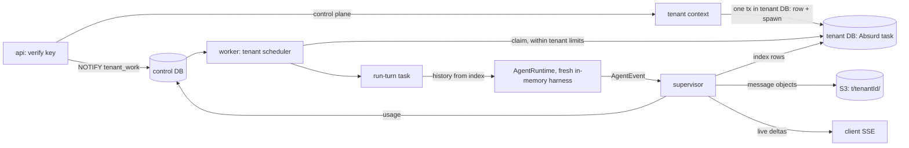

# Architecture

Kerby is an agent runtime sold as a service. Customers (tenants) call it over HTTP; it runs their agents durably,
calls the tools they register, and keeps every transcript. Postgres is the only service it needs (plus S3-compatible
storage for bytes). Why: ADRs [0001](docs/adr/0001-platform-and-tenancy.md),
[0002](docs/adr/0002-postgres-absurd-s3.md), [0003](docs/adr/0003-harness-agnostic-runtime.md),
[0004](docs/adr/0004-database-per-tenant.md), [0005](docs/adr/0005-dependencies.md) (dependency list), [0006](docs/adr/0006-schema-lives-in-packages.md), [0007](docs/adr/0007-railway-hosting.md), [0013](docs/adr/0013-exports-and-bucket-backup.md), [0014](docs/adr/0014-tenant-console.md).

```
scripts/    occasional tooling and repo checks; not product
packages/   libraries, imported as @kerby/<dir>
services/   deployables: api (tenants' code calls it), worker (runs turns), control (operators run it), console (tenants'
           people sign up, manage keys and chat in it); they own no tables
docs/       what an agent must know that the code does not say
```

Every rule below is enforced by `make architecture` ([scripts/check-architecture.ts](scripts/check-architecture.ts))
unless marked _review_. A failure message names the fix. Fix the code; changing a rule needs an ADR. Docs are checked
by `make docs` ([scripts/check-docs.ts](scripts/check-docs.ts)): relative links resolve, and every `make` target and
rule a doc names exists. `make knip` ([knip.jsonc](knip.jsonc)) fails on dead files, exports no workspace imports
(package entry files included), and unused or undeclared dependencies: delete them, or tag a deliberate keep `@public`
with the reason.

## Workspaces

- A workspace is `packages/<dir>` or `services/<dir>`, named `@kerby/<dir>`; `<dir>` is unique across both.
- `scripts` and `services` import packages. Packages import packages. **A service is never imported**:
  services meet over HTTP, with the schemas in `packages/contracts`.
- A relative import never leaves its workspace.
- No build step: `exports` points at `src/index.ts` and Node runs TypeScript directly (`erasableSyntaxOnly`). The one
  exception is the console's pages, which `next build` compiles when its image is built (ADR 0014).

## Layers

Inside a service, `src/` holds `index.ts` and these directories. A layer imports itself and layers to its left.

```
types -> config -> repo -> service -> runtime
```

| Layer     | Holds                                                                                                  |
| --------- | ------------------------------------------------------------------------------------------------------ |
| `types`   | Types and schemas local to the service.                                                                |
| `config`  | The service's config schema (read once, validated at start).                                           |
| `repo`    | SQL. The only layer that touches a database, always through a `ControlDb` or `TenantDb` argument.      |
| `service` | Business logic. Takes ports (`AgentRuntime`, blobs) and a tenant context as arguments.                 |
| `runtime` | HTTP routes and Absurd task handlers. Authenticates, builds the tenant context, wires layers together. |

`src/index.ts` is the composition root: it builds the real adapters and hands them down. Tests may import any layer.

A service built on Next.js (the console) keeps its pages and server actions in `src/app`, where Next.js looks for them:
that is its `runtime` layer. Next.js bundles `src/app`, so it imports Kerby packages and the rest of `src/` with
`import type` only, and reaches values through what `src/index.ts` installed (`consoleService()`); otherwise the bundle
would hold second copies of packages the composition root already built (enforced, rule `layers`; ADR 0014).

## Providers

Each external system lives behind exactly one package; nothing else imports the SDK.

| System                       | Only `packages/...`  | Package offers                                                              |
| ---------------------------- | -------------------- | --------------------------------------------------------------------------- |
| Postgres (`pg`)              | `db`                 | `ControlDb`, `TenantDb`, the tenant pool registry, migrations (both planes) |
| Absurd (`absurd-sdk`)        | `durable`            | task names and params, spawn, register, the tenant scheduler's claim loop   |
| S3 (`@aws-sdk/client-s3`)    | `blobs`              | `put`/`get`/`delete` by tenant context; raw-key `Bucket` for control only   |
| Pi Durable and its libraries | `runtime-pi-durable` | an `AgentRuntime`                                                           |
| Tenant-supplied URLs         | `egress`             | a `fetch` that reaches only public addresses (ADR 0010)                     |

An agent harness is replaceable by construction: `packages/agent` defines `AgentRuntime` and `AgentEvent`;
`packages/runtime-<harness>` adapts one harness to it; only a service's `src/index.ts` may import an adapter.

## Tenancy

A tenant is an untrusted customer. Isolation is structural: a database per tenant, a key prefix per tenant.

| Plane   | Database                                             | Holds                                                                                                                                                                                            | Migrations                                                  |
| ------- | ---------------------------------------------------- | ------------------------------------------------------------------------------------------------------------------------------------------------------------------------------------------------ | ----------------------------------------------------------- |
| Control | one, operator-owned                                  | `tenants` (status, plan, limits, region, locators), `api_keys`, encrypted `tenant_secrets`, sealed `tenant_db_credentials`, `usage`, audit, the console's `console_users` and `console_sessions` | `packages/control-plane/migrations/control/`                |
| Tenant  | one per tenant, on a cluster the control plane names | conversations, messages, blob index, tool registrations, the Absurd schema                                                                                                                       | `packages/{durable,blobs,conversations}/migrations/tenant/` |

- Every `.sql` migration lives in a `migrations/control/` or `migrations/tenant/` directory of the package that owns the tables (ADR 0006). A control table has `tenant_id` or `-- global: <reason>`
  on the line above `create table`. A tenant table needs no tenant column: the database is the boundary.
- `packages/db` exports `ControlDb` and `TenantDb` as distinct types. Repo functions take one, never a pool or DSN. A
  `TenantDb` comes only from a verified API key resolved in the control plane.
- A tenant id reaches code only through a verified API key (api), a verified console session (console, and the api when the
  console forwards one for the browser's chat), never through a request body or a URL. _review_
- `AgentRuntime` never sees a tenant, user, or conversation id; Kerby's closures carry them.
- Object keys start with `t/<tenantId>/`; `packages/blobs` takes a tenant context on every call from api and worker
  (`Blobs`). Only `control` uses its raw-key `Bucket`: tenant prefixes (export, deletion), the export bucket and the
  nightly backup copy ([ADR 0013](docs/adr/0013-exports-and-bucket-backup.md)).
- Tenants bring their own model keys ([ADR 0008](docs/adr/0008-byok-sealed-secrets.md)); Kerby holds no provider key. A key is
  sealed by `packages/secrets` to a public key the api and the console hold, stored in the control plane's `tenant_secrets`, and
  opened only by a worker (the private key) inside the run that uses it. Tool credentials will follow the same path. Logs carry the
  tenant id, never message content or secrets; the worker scrubs the key from provider errors. _review_
- No tenant code runs in Kerby's processes. Tools are remote MCP servers. Every call to a URL a tenant supplied goes
  through `createEgressFetch` from `packages/egress` ([ADR 0010](docs/adr/0010-egress-guard.md)): public addresses
  only, connected to the address it checked, redirects re-checked, time and size limits. _review_
- Lifecycle is an operator command in `services/control`: provision, suspend, export, delete, rotate the database password.
  Provisioning copies the template database (migrated at startup) and creates a role that owns that database and may
  connect to no other tenant database, with a random password of its own ([ADR 0009](docs/adr/0009-tenant-database-credentials.md)):
  stored in `tenant_db_credentials` sealed by `packages/secrets` under `TENANT_DB_KEYS` (tenant id as authenticated data),
  which control, api and worker hold. `TenantPools` resolves a tenant's URL from it and its pools look the password up
  again at every login, so a rotation needs no restart. At startup control gives a password to every tenant lacking one, re-seals those under an older key,
  and closes the maintenance databases (`postgres`, `template1`) and the template to everyone but its admin role, as it
  does the control database: a tenant role can open its own database and nothing else.
  Deleting drops the database and role, deletes the object prefix and purges keys and the console's people and sessions;
  the row stays with status `deleted`. Exporting uploads a `pg_dump` and the object listing to the export bucket and
  returns presigned URLs; exports are kept 30 days. Nightly, control copies new objects to the backup bucket and drops
  deleted tenants' copies (ADR 0013).
- Self-serve sign-up ([ADR 0014](docs/adr/0014-tenant-console.md)): the console hashes the password and calls control's
  `POST /v1/console/signups` with `CONSOLE_TOKEN` (which opens that route only); control provisions as above and stores
  the person (`console_users`, one account per email). A console session is a random token in an HttpOnly, Secure cookie,
  kept as its SHA-256 (`console_sessions`, 7 days); it stops at once when the tenant is not active. The console connects as
  `kerby_console`: API keys (never their hashes), model keys, people and sessions, appending to the audit log as
  `user:<id>`. Before sign-in it bounds work per client address (sign-ups an hour, failed sign-ins a minute) and per
  account (failed sign-ins an hour), per process like the api's limits.
- Limits live in the tenant row (`limits`, [`LimitsSchema`](packages/contracts/src/operator.ts), set at provisioning);
  an absent key takes the service's default. `requestsPerMinute` (api `DEFAULT_REQUESTS_PER_MINUTE`, 600) is a token
  bucket per tenant **per api process**, so it is approximate: N processes allow up to N times it; past it a request is
  429 `rate_limited` with `Retry-After`. `storageBytes` (api `DEFAULT_STORAGE_BYTES`, 1 GiB) is checked against
  `sum(size)` of the tenant's blob index when a message is posted, before anything is stored and again inside the post's
  transaction: 413 `storage_quota_exceeded`; a turn already admitted finishes. Before a key is verified, the only work is
  the key lookup: a client address that fails `FAILED_AUTH_PER_MINUTE` (30) times in a minute gets 429 without one. The
  address is the socket peer, or with `TRUST_PROXY=true` (Railway, whose edge sets `X-Forwarded-For` with the client
  first) the left-most `X-Forwarded-For` entry. The numbers are defaults until pricing (plan 0001, M9).

## Durability: the turn lifecycle

The harness is disposable. Kerby owns durability by persisting what the harness reports, in the tenant's own database and prefix.



1. **Schedule.** The worker learns of work from the control plane's `NOTIFY` (a periodic sweep catches missed ones) and
   claims from that tenant's database only while the tenant is under its concurrency limit, counted across every
   worker: the claim runs in a tenant-database transaction holding an advisory lock, counts the turns running there
   under a live lease and claims at most the difference. A worker already at the limit by itself does not ask. A worker
   also caps its running turns across all tenants (`MAX_RUNNING_TURNS`, default 50), which bounds its tenant
   connection pools: it reserves slots before a claim and never claims more than it can run, and a tenant that asks
   while the worker is full waits its turn (longest-waiting first), so a busy tenant cannot hold the slots against others.
2. **Rehydrate.** The task reads the conversation's messages from the tenant's index (bodies from S3) and starts a
   fresh in-memory harness with them as `AgentRun.history`. Workers hold no state, so any worker takes any turn. A tool
   call in the history without a persisted result is resolved first through `executeTool` (a cached step), never left to the harness.
   The history has a byte budget (`HISTORY_BUDGET_BYTES`, default 8 MiB): the worker walks the index newest first using
   the blob index's sizes, fetches only what fits, and cuts only before a user message, so the history starts a turn and
   a tool call never loses its result. Older turns past the budget are left out (logged with counts, never content); the
   turn being answered is always whole. Nothing is deleted: the index keeps every message.
3. **Run.** The adapter turns the harness's native events into `AgentEvent`s. That mapping is the only
   harness-specific transformation; everything downstream sees one format. The supervisor heartbeats the Absurd lease
   for as long as the run lasts, including a model call that writes no checkpoint.
4. **Persist before act.** The supervisor writes each `message_end` (an S3 object under a deterministic key, then an index
   row, then an Absurd step) before the next event is pulled. A tool runs only after the message that requested it is persisted.
   The index insert is **fenced**: it succeeds only while this run is still the task's latest (`last_attempt_run`), under a
   row lock on the task, and `(conversation, seq)` is unique. A worker whose lease lapsed cannot write a divergent message.
5. **Tools run once.** `AgentRun.executeTool` is an Absurd step keyed by conversation and tool-call id: a retry gets the
   stored result instead of repeating a side effect.
6. **Retry** is a rerun of step 2 onward. The conversation resumes after its last persisted message.

- **One turn at a time per conversation.** Posting a message while a turn is queued or running is a 409; the check and the
  insert share a row lock on the conversation, so concurrent posts serialize.
- **Object keys carry a content hash** (`conversations/<id>/messages/<seq>-<sha16>.json`): a retry of the same message
  overwrites itself, and a stale writer's different content lands under a different key and can never replace bytes an
  index row already points at.
- **Paged reads.** `GET /v1/conversations/:id?after=<seq>&limit=<n>` returns one page (default 100, at most 500) and
  `nextAfter`, null on the last page. A conversation still holds at most 2000 messages and 64 MiB: those bound storage,
  not memory.
- **Browsing.** `GET /v1/conversations?limit=<n>&cursor=<c>&externalUserId=<id>` lists the tenant's conversations, most
  recently active first (`updated_at`, written by both message writers), with title and message count; `nextCursor` holds the
  last row's `updated_at` to the microsecond and its id. The console's chat uses it and the rest of this API with the person's
  session token ([ADR 0014](docs/adr/0014-tenant-console.md#amendment-chat-and-browsing-in-the-console-2026-11-22)).
- **Streaming.** `GET .../events` replays persisted messages from the index after `Last-Event-ID` (the message `seq`), a page at a time,
  then tails the tenant database with `LISTEN`: the worker `NOTIFY`s `{persisted: seq}` when a message commits and live
  events (deltas, tool events) in full when they fit in 7500 bytes. Live events carry no SSE id and are not replayed;
  a poll every 5 s is the backstop for a lost notification. All streams on one tenant database in an api process share
  one `LISTEN` connection; a process caps its open streams per tenant (429) and in all (503), to stay inside the
  connection budget in [docs/deploy.md](docs/deploy.md#postgres).

Source of truth for a conversation is the tenant's index plus S3, never Absurd checkpoints: Absurd's retention
cleanup may delete those. Checkpoint values stay small JSON (references, not bodies).

## Configuration

- A service declares a zod schema in `src/config/` and calls `loadConfig` from `@kerby/config` once, in `src/index.ts`.
  Sources, lowest to highest: a YAML file (`KERBY_CONFIG_FILE`), environment variables, a secrets directory
  (`KERBY_SECRETS_DIR`, one file per secret). A key `databaseUrl` is `DATABASE_URL` in the environment.
- Failure lists every bad key and never a value. Unknown keys in the file fail.
- Only `packages/config` and `scripts/` read the process environment. Enforced (rule `config`).

## Local stack

`make up` runs [compose.yaml](compose.yaml): Postgres, RustFS, `control`, `api`, `worker`, `console`, built from each service's
`Dockerfile` (`dev` and `prod` targets, `node:<.node-version>-slim`, run as `node`, a `HEALTHCHECK` each: enforced, rule `docker`),
then provisions a `default` tenant through the operator API and prints its key. The same images run hosted.

- Two published ports: the API on `127.0.0.1:${KERBY_API_PORT:-8080}` and the console on
  `127.0.0.1:${KERBY_CONSOLE_PORT:-3000}` (sign up there for a workspace of your own). Control and worker are reached only
  inside the network (`make up` provisions through `docker compose exec`).
- The project name is `kerby-stack` (override with `KERBY_PROJECT` for a second checkout), so volumes and containers of
  two worktrees never meet. `make down` keeps data; `make down-v` removes containers, volumes and built images.
  `make worktree NAME=<name>` makes a checkout under `worktrees/<name>` with its own project and port pair in `.env`.
- The worker runs the scripted fake model and the `echo` tool (`KERBY_ENVIRONMENT=development`, `KERBY_FAKE_MODEL=1`); the
  worker refuses `KERBY_FAKE_MODEL` outside development. For a real model, bring a key like a tenant does: start with
  `KERBY_FAKE_MODEL=0 KERBY_KEYLESS_PROVIDERS= KERBY_DEFAULT_MODEL=<provider>/<model> make up`, then
  `PUT /v1/model-keys/<provider>` with `{"apiKey": "..."}` using the tenant's API key. Compose carries a development secrets
  key pair; `make secrets-key` makes a real one.
- Scale workers with `docker compose up -d --scale worker=2`; any worker takes any turn. The local worker's lease is 10 s
  (`CLAIM_TIMEOUT_SECONDS`), so a killed worker's turn moves in seconds.
- `make multitenant` (scripts/multitenant.ts) is the proof of isolation on the real stack: two tenants, cross-tenant attempts
  on conversations, streams, database roles, tasks, object prefixes and keys, suspension within the auth cache TTL
  (`AUTH_CACHE_SECONDS`, 3 s locally, 30 s by default), then a load run (`KERBY_LOAD_TENANTS`, default 200) with a
  stream-saturation phase: a second api process, both filled to their stream cap, peak connections per process and role.
- `make e2e` (scripts/e2e.ts) is the proof on the real stack: two workers, an SSE stream, `docker kill` of the worker
  holding a turn mid-flight, then checks that the turn finished elsewhere, the tool ran once and every message exists once.
- `make test` runs on disposable containers (scripts/test-containers.ts), not this stack; `make e2e` and
  `make multitenant` are the real-stack runs. There is no tracing: logs are the record until a profile needs more.
- Every process writes JSON lines (`@kerby/observability`: `at`, `level`, `msg`, `tenantId`, scalar fields, never
  content). `make logs-query` filters them: `TENANT=<id>`, `LEVEL=warn` (that level and worse), `MSG=<substring>`,
  `SERVICE=api`, `SINCE=30m`/`UNTIL=` (a duration back from now or ISO 8601); it reads this stack's `docker compose logs`
  (honoring `KERBY_PROJECT`), or Railway's with `ENV=<environment>`. A failure an operator must hear about is an
  `alert(kind, fields)`: an error line with `alert: <kind>`, also posted to `ALERT_WEBHOOK_URL` when set
  (`KERBY_ALERT_WEBHOOK_URL` here) and debounced per kind; see docs/deploy.md#alerts.

## Hosting

Railway, described by Infrastructure as Code in `.railway/railway.ts` (`make railway-plan`, `make railway-setup`) and rolled out by `scripts/railway.ts` (`make deploy`): one project, a `production` environment (any other name is an
ephemeral copy), and per environment a `Postgres` service, a bucket (plus `control`'s export and backup buckets), and `control`, `api`, `worker` and `console` running the images CI builds from
the Dockerfiles Compose runs and pushes to GHCR; a merge to `main` releases: [ADR 0007](docs/adr/0007-railway-hosting.md),
[ADR 0011](docs/adr/0011-images-from-ghcr.md), runbook in [docs/deploy.md](docs/deploy.md). Only `api` and `console` are public; services reach
Postgres and each other over Railway's private network (the console reaches control's sign-up route and the api there), and the bucket through
its S3 endpoint and keys. The secrets private key is a variable on `worker` only; the api and the console get the public half.

## Dependencies

- One version of everything, in the `catalog:` of `pnpm-workspace.yaml`, exact pins. Workspaces say `"catalog:"`;
  `@kerby/*` say `"workspace:*"`. An import must be declared by its workspace.
- A new dependency is a catalog line plus an ADR line (what, why, alternatives).
- pnpm refuses versions younger than 7 days (`minimumReleaseAge`). Pick the newest older one; leave the setting.
- Node version: `.node-version`. pnpm: `packageManager` in `package.json`.
