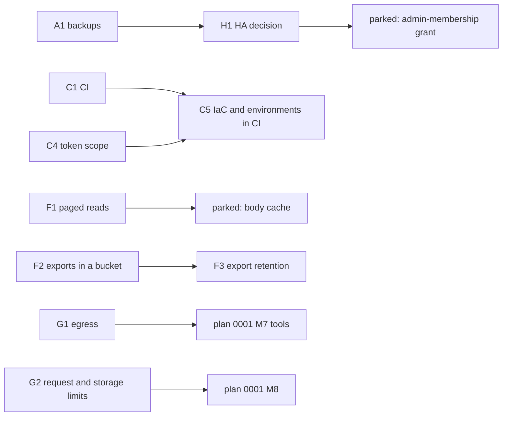

# 0003. Pay down the tech debt

Goal: every line of [tech-debt.md](../tech-debt.md) is paid, closed by a recorded decision (an ADR, plan 0001), or
parked behind a named trigger. Each item quotes the start of its debt line; remove that line and tick the box in the same
commit. "Now" facts were checked against the code on 2026-11-22. Sizes: S under half a day, M one to two days, L more.

## Open questions (block the named item)

- Where alerts go and who answers them (a webhook into a chat channel, email). Blocks D2, D3.
- Recovery targets: data that may be lost (RPO) and outage that may last (RTO) once tenants pay. Blocks H1; sets A1's
  schedule (daily and weekly until answered).
- Export retention: days an export is kept, and whether a deleted tenant's last export outlives it. Blocks F3.
- History over the worker's budget: drop the oldest turns at a user-message boundary (default) or refuse the turn with
  413. Blocks the worker half of F1.
- A Git remote and a CI host (`.railway/README.md` assumes GitHub Actions). Blocks C1, C5.
- An edge in front of `api` (a proxy on a custom domain) and an uptime monitor. Blocks D3.

## Order

Milestones run in letter order; A and B come before a real tenant stores data. Dependencies across them:

## A. Do not lose data

- [x] **A1 Postgres backups** ("Hosting (ADR 0007): no backups"). S, needs Railway access.
  Now: `.railway/railway.ts` declares `postgres-volume` with usage alerts and no backups. The pinned `railway` SDK types
  accept `backupSchedules: ("DAILY" | "WEEKLY" | "MONTHLY")[]` on a volume mount.
  Fix: declare `DAILY` and `WEEKLY`; `make railway-plan` shows it; after `make railway-setup` a second plan is clean. If
  apply does not keep it, set it in the dashboard and name it under "What is NOT here" in the file's header.
  Proof: restore the newest backup outside production and read a known conversation through that environment's api.
  Write the procedure and the measured restore time in docs/deploy.md; drop "no backup" from deploy.md and ADR 0007.
- [x] **A2 Secrets private key copy** ("Secrets private key: lives only as a Railway variable"). S, **human**.
  Copy `SECRETS_PRIVATE_KEYS` from `worker` to a store outside Railway. Prove the copy: `publicKeyOf(copy)`
  (`packages/secrets`) equals `api`'s `SECRETS_PUBLIC_KEY`. Write where it lives (never the value) and the check in
  docs/deploy.md. Do it with A1: a restored database without this key restores no model key.
- [x] **A3 Bucket copy** ("The bucket has no copy outside itself"). M.
  Now: `bucket("kerby")` has no versioning or replication, and message bodies live only there, so A1 alone restores an
  index that points at nothing.
  Fix: use what Railway buckets offer (versioning, replication) if anything; otherwise copy `t/` on a schedule to a second
  S3-compatible store through `packages/blobs`. Message keys carry a content hash, so an incremental copy never overwrites.
  Proof: in a scratch environment delete an object, restore it from the copy, read the conversation.

## B. Isolation and capacity

- [x] **B1 Maintenance and template databases** ("A tenant role can still `connect`"). S.
  Now: `restrictControlDatabase` (`packages/control-plane/src/app-role.ts`) and `ClusterAdmin.restrictDatabase` cover the
  control and tenant databases. `postgres`, `template1` and the tenant template (`kerby_tenant_template`, made by
  `ensureTemplate` without a restriction) still admit `public`. A session held in the template also makes provisioning
  fail: `create database ... template` retries `55006` for 5 s, then throws.
  Fix: at control startup, revoke `connect` from `public` on all three and grant it to `current_user`. A non-owner revoke
  only warns, so the proof is a refused connection, not the statement.
  Proof: a control test where a provisioned tenant role is refused by all three (over the network address, as
  `make multitenant` does); the same check added to `scripts/multitenant.ts`.
- [x] **B2 Turn limit across workers** ("A tenant's concurrent-turn limit is counted per worker process"). M.
  Now: `services/worker/src/service/scheduler.ts:50` subtracts this process's `running` map from `maxConcurrentTurns`.
  Fix: `packages/durable`'s executor claims inside a tenant-database transaction holding `pg_advisory_xact_lock`, counts
  `absurd.r_turns` rows with `state = 'running' and claim_expires_at > now()`, and claims at most the difference (through
  the SDK on the pool's other connection). Keep the local count as a fast path: local at limit means global at limit.
  Proof: two schedulers over one tenant (the `worker.test.ts` pattern), limit 2, five slow turns: never more than two
  running, all five finish. Update ADR 0004's "worker serves many databases" and ARCHITECTURE.md step 1.
- [x] **B3 Connection budget** ("Hosting: Postgres runs with the template's `max_connections`", "The tenant-role
  connection limit ... is a guess", "Connections per api process have no ceiling"). L.
  Now: `ctx.db.listen` opens a new `pg.Client` per call (`packages/db/src/handles.ts:129`), so each event stream holds
  one connection and leases its tenant's pool; `TenantPools` evicts only idle pools, so `maxPools` (50) is soft. Streams
  are capped per tenant per process (`MAX_STREAMS_PER_TENANT`, 20) and nowhere else. Railway's `max_connections` is 100.
  Fix, in order: one `LISTEN` client per tenant database per api process, shared by that tenant's streams; a per-process
  stream cap (`MAX_STREAMS_PER_PROCESS`, 503 when full); the budget formula in docs/deploy.md (processes times pools
  times pool size, plus listeners, control pools and reserved slots); raise `max_connections` (a start option in the IaC
  if the Postgres template takes one, else `ALTER SYSTEM` once per environment, written down); then measure.
  Proof: `make multitenant` with two api replicas and a stream-saturation phase records peak `pg_stat_activity`;
  `TENANT_ROLE_CONNECTION_LIMIT` and `MAX_STREAMS_PER_TENANT` are set from those numbers and logged here.
- [x] **B4 Unknown model provider at `PUT`** ("Model keys (ADR 0008): the api accepts a key for any well-formed provider
  id"). S. Pays the first sentence; the rest is parked below.
  Now: `ModelProviderSchema` checks the format only; `SUPPORTED_PROVIDERS` lives in the adapter, whose `providers.ts`
  imports every Pi provider module.
  Fix: export the id list from a subpath of `@kerby/runtime-pi-durable` that imports no Pi code (a test keeps it equal to
  the provider map); `services/api/src/index.ts` (a composition root may import an adapter) injects it; an unknown id is
  400 `unknown_provider` naming the supported ones. The adapter still owns the list, as ADR 0008 says.
  Proof: api test; `curl -X PUT .../v1/model-keys/nope` on the local stack.

## C. Ship through a gate

- [x] **C1 CI** ("Ephemeral environments are created and deleted by whoever runs", first half; plan 0001 M0). M,
  **human**: create the remote and its secrets.
  Fix: a workflow running `make setup`, `make check`, `make test` on every push and pull request (hosted runners have
  Docker, which `scripts/test-containers.ts` needs); `make e2e` and `make multitenant` nightly. Actions pinned by commit
  SHA (versions live once). Ticks plan 0001 M0.
- [x] **C2 knip** ("`knip` (dead code, unused dependencies) is not wired"). S. Overdue: three services exist.
  Risk: the catalog pins TypeScript 7.0.2, which has no JavaScript API (`createSourceFile` is undefined); confirm the
  chosen knip version runs without it before adopting. Fix: catalog pin and ADR 0005 line, a config naming the entries
  (`services/*/src/index.ts`, package `exports`, `testing.ts`, tests, `scripts/*.ts`, `.railway/railway.ts`), a `knip`
  Makefile target inside `make check`; delete what it finds. If no knip version runs, close the line with that reason.
- [x] **C3 Doc checks** ("No automated doc-freshness pass"). M.
  Fix: `scripts/check-docs.ts` in `make check`: relative links in every `.md` resolve; every `make <target>` the docs name
  exists in the Makefile; every rule a doc calls enforced exists in `check-architecture.ts`. The semantic pass (ADR
  decisions and AGENTS.md invariants against code) runs at each milestone close, and on a CI schedule once C1 exists.
- [x] **C4 Railway token scope** ("Hosting: whoever holds the Railway login can read every secret"). S, **human**: create
  the tokens.
  Measure which commands `scripts/railway.ts` uses (`environment new --duplicate`, `variable set`, `domain`, `up`, `config
  apply`, `environment delete`) succeed under a project token scoped to one environment. Outcome: agents get tokens for
  non-production environments only; production changes go through C5 or a person. Record it in ADR 0007 and deploy.md.
- [x] **C5 IaC and environments in CI** (same line, second half). M. After C1 and C4.
  Fix: `railwayapp/config` plans on pull requests and applies on merge; a pull request gets `ENV=pr-<n>` (setup, deploy,
  a smoke call), deleted with `make env-down` on close.
- [ ] **C6 Orphan bucket** ("IaC and buckets: an environment filled in from the file alone"). S, **human**.
  Delete `modular-safe-wx5G` in the dashboard. The empty-environment limitation is already an ADR 0007 decision
  ("verified"), so the line goes; retry an empty environment whenever the `railway` pin is bumped (note in
  `.railway/README.md`).

## D. See failures

- [x] **D1 Queryable logs** ("M3 asks that `make test` run against the real stack"). M.
  Decision: `make test` stays on disposable containers; `make e2e` and `make multitenant` are the real-stack runs (log in
  plan 0001 and tick its M3 item). No traces until a profile needs them.
  Fix: `scripts/logs.ts` (`make logs-query`) reads JSON lines from `docker compose logs`, or from `railway logs` for
  `ENV=<name>`, and filters by `tenantId`, `level`, `msg` and time. Check the Railway CLI's JSON output first.
- [ ] **D2 Alerts** ("Hosting: no alarms, dashboard or error alerting"). M, **human**: the destination.
  Fix: Railway notifications for a failed deploy and a crashed service (dashboard; the IaC types have no notification
  setting). In `packages/observability`, `alert(kind, fields)` logs and posts to `ALERT_WEBHOOK_URL` (required outside
  development), debounced per kind, for `turn failed for good`, `lease lost`, a failed provisioning and a failed migration
  fan-out. Tenant ids only, never content. Proof: a test against a local receiver; one alert seen at the destination
  from a scratch environment.
- [x] **D3 Edge and synthetic check** ("Hosting: no edge rate limiting or WAF"). M, **human**: the edge and monitor.
  Fix: the chosen edge in front of a custom api domain, rate limiting there; in `services/api`, a per-address limit on
  failed authentications (the only pre-auth path); an external monitor on `GET /healthz` plus an authenticated read by a
  canary tenant, alerting through D2.

## E. Credentials

- [x] **E1 Per-tenant database credentials** ("Every tenant role's password derives from one shared secret"). L. ADR first.
  Now: `tenantDbPassword` (`packages/control-plane/src/tenants.ts`) is an HMAC of `TENANT_DB_SECRET` and the tenant id,
  used by api, worker and control. That secret alone opens every tenant database.
  Proposal: a random password per tenant, stored in the control plane encrypted with a versioned symmetric key
  (`TENANT_DB_KEYS`, tenant id as authenticated data) held by control, api and worker. Not the ADR 0008 pair: the api
  must open the credential to connect, and must never hold the model-key private key.
  Cutover (expand, then contract): store each tenant's current derived password; deploy api and worker reading the
  stored one; an operator command rotates each tenant to a random password (`alter role`, store, pools evicted on
  `28P01`); delete `TENANT_DB_SECRET`, `tenantDbPassword` and their docs. Proof: rotation test with a live turn; then
  rotate one tenant on a scratch environment.

## F. Bounded data paths

- [x] **F1 Paged reads and a history budget** ("A conversation is capped at 2000 messages", and the paging half of "A
  conversation read fetches every message body"). M.
  Now: `readMessages` (`packages/conversations/src/messages.ts:193`) loads every message, eight S3 gets at a time, for
  `GET` conversation, SSE replay and the worker's rehydrate; the contract has no paging.
  Fix: `GET /v1/conversations/:id?after=<seq>&limit=<n>` (default 100, max 500) returns `nextAfter`; SSE replay reads in
  pages; the worker reads newest-first within `HISTORY_BUDGET_BYTES` using index sizes, never splitting a tool call
  from its result (behavior past the budget: open question). The caps stay; they bound storage, not memory.
  Proof: a 600-message conversation paged in tests and on the local stack; a worker test where the harness sees only the
  newest whole turns. Document in ARCHITECTURE.md step 2.
- [x] **F2 Exports in a bucket** ("Tenant exports are written to the control container's disk"). M.
  Now: `services/control/src/service/export.ts` writes `<name>-<id>-<stamp>.dump` and `.objects.json` under `exportDir`
  and returns those paths.
  Fix: a second bucket that only `control` holds keys for; upload then delete the local file (a single put caps an
  export at 5 GiB: noted); return presigned URLs with an expiry (presigning is a new dependency: catalog pin, ADR 0005
  line; RustFS presigning is untested, spike S3). The export store lives in `packages/blobs` (one door to S3); amend
  ARCHITECTURE.md where it says blobs takes a tenant context on every call. Audit each URL issued.
  Proof: control test against RustFS fetches the URL, and is refused after expiry; one export on a scratch environment.
- [x] **F3 Export retention** ("Deleting a tenant keeps its export files"). S. After F2 and the retention answer.
  Fix: a bucket lifecycle rule if Railway buckets support one; otherwise control deletes expired exports at startup and
  daily. Proof: test with an injected clock.

## G. Before plan 0001 milestones

- [x] **G1 Egress guard** ("Not built: `egress`"; plan 0001 M2). L. Before the first tool (M7) or custom base URL.
  Fix: `packages/egress` on Node built-ins: resolve all addresses and refuse private, loopback, link-local (metadata),
  CGNAT, unique-local and mapped IPv6 ranges with `net.BlockList`; connect to the address that was checked (no second
  lookup, so no DNS rebinding); follow redirects by hand, re-checking each hop, with a hop limit; time and size limits
  on request and response; a `fetch`-shaped function, since MCP and provider clients take one. Tests inject the block
  list so a loopback server can serve the success path. A row in ARCHITECTURE.md#providers.
- [x] **G2 Request rate and storage quota** ("No per-tenant request rate limit and no storage quota"). L. Plan 0001 M8.
  Fix: a per-tenant token bucket in each api process from `limits.requestsPerMinute` (approximate across processes,
  stated in docs); `limits.storageBytes` checked against `sum(size)` of the tenant's `blobs` index in
  `postUserMessage`'s transaction (413 `storage_quota_exceeded`; an admitted turn finishes); stored bytes reported to
  `usage`. Numbers wait for M9 pricing; defaults until then.

## H. Decisions

- [x] **H1 High availability** ("Hosting: one Postgres instance on one volume"). M: an ADR, then its work.
  Options: (a) one instance plus A1 and A3, RTO measured in A1; (b) WAL archiving to a bucket for point-in-time recovery
  (a custom Postgres image and a new tool); (c) a Railway replica, if its Postgres offers one (the SDK types have
  `clusterRole` and `replicaConfig`, unverified for Postgres); (d) managed Postgres elsewhere, an ADR 0007 change that
  likely brings a non-superuser admin. Default: (a) until tenants pay.
- [x] **H2 Sleep** ("Hosting: `api` and `worker` never sleep"). S. Cost only: last.
  Turn `sleepApplication` on for `api` in a scratch environment; measure whether it sleeps with pools and streams, the
  cold start, and an open stream across the threshold. Enable it in the IaC or record the result in ADR 0007. The worker
  stays awake: its scheduler sweeps every 10 s.

## Parked behind a trigger

No work until the trigger; the debt line stays and names it.

- **Import scanner** ("The import scanner in `check-architecture.ts` is regex-based"). Trigger: the first false positive.
  Fix then: a pre-pass in `specifiers()` that blanks comments and string contents, no dependency (TypeScript 7.0.2 has
  no JavaScript API), with the false positive as a regression test.
- **Conformance suite** ("`AgentRuntime` has one adapter"). Trigger: a second adapter is proposed. Fix then: lift the
  port-contract cases out of `runtime-pi-durable/src/runtime.test.ts` (event order, persist-before-act gate, rehydration
  without repeating a tool, unanswered tool calls through `executeTool`, refusal) into `@kerby/agent/testing`.
- **Admin-membership grant** (paid in PR #8: deleted, ADR 0012) ("`reassignOwned` (packages/db) moves ownership by hand"). Trigger: H1. Correction:
  `reassignOwned` runs on every host, Railway included, because a superuser cannot `REASSIGN OWNED` its own objects and
  the tenant role must own its schema to migrate it. Only `grant <role> to current_user` in `createRole` serves the
  non-superuser path; delete it if H1 keeps a superuser admin.
- **Body cache** (the rest of "A conversation read fetches every message body"). Trigger: after F1, a profile shows S3
  gets dominating a read or a rehydrate. Fix then: a per-process LRU of bodies bounded in bytes and keyed by object key;
  keys carry a content hash, so nothing is ever invalidated.
- **Re-seal** (the rest of the model-keys line). Trigger: the first secrets key rotation. Fix then: a script run where
  the private keys are (`worker`) that opens each `tenant_secrets` row whose embedded key id is not the current key's,
  re-seals it, and audits it. The console is plan 0001 M9, not debt.

## Log

- 2026-11-22 Plan written. Every tech-debt.md line checked against the code. Corrections made there: `reassignOwned` is
  needed on Railway too; the tenant template database also admits `public`. New lines: no copy of the bucket, no
  per-process connection ceiling (one `LISTEN` connection per event stream).
- 2026-11-22 G1: `packages/egress` (ADR 0010): `createEgressFetch`, a `fetch` that reaches only public addresses (every
  resolved address checked with `net.BlockList`, mapped/NAT64 IPv6 included), connects to the checked address through a
  pinned `lookup`, re-checks every redirect hop (limit 5, no https→http, credentials dropped across origins), one deadline
  and request/response byte limits; any port. Not wired: no caller until plan 0001 M7. PR #2.
- 2026-11-22 Remote `samchristensen/kerby` (private); CI `check` and `test` on every PR and push, `main` protected. The first
  CI run caught a real bug: `serve` lost a stream's abort when the Request was garbage collected (undici links its signal
  through a WeakRef), so SSE streams outlived their clients; fixed, the test forces a GC (PR #1). Parallel `make test`
  runs no longer remove each other's containers (owner pid label, regression test).
- 2026-11-22 C1/ADR 0011 (PR #3): CI builds the three images and pushes `ghcr.io/samchristensen/kerby-<svc>:sha-<commit>`
  on main; Railway services run `kerby-<svc>:<environment>` (IaC `image()`, Railway passes the environment name); release
  on merge moves the tag (`imagetools create`) and `railway redeploy --from-source`, control first; IaC plan on PRs.
  `uptime` (GET /healthz every 15 min) and `nightly` (`make e2e`, `make multitenant`) workflows. Preview environments stay
  manual: a project token cannot create environments.
- 2026-11-22 A1: daily volume backups on production (`railway postgres pitr schedule set --daily`, kept 6 days; the IaC
  export does not show volume attachments and declaring one plans a re-attach, so the schedule lives outside the file).
  Restore drill in a copy environment `drill`: marker row, on-demand backup, second row, restore: back with only the first
  row after 77 s; environment deleted. A2: `SECRETS_PRIVATE_KEYS` copied to the operator's macOS login keychain; the
  copy equals the live value and its public key equals `api`'s `SECRETS_PUBLIC_KEY`.
- 2026-11-22 H1/H2 (ADR 0012): RPO 24 h (nightly), one instance until a tenant pays (then PITR) or an SLA is sold (then
  `railway postgres ha convert`); the admin stays a superuser, so the non-superuser provisioning path goes; nothing
  sleeps. C6: the orphan bucket `modular-safe-wx5G` has no instance in any environment; `railway bucket delete` refuses
  it and an environment patch marking it deleted did not remove it: delete it in the dashboard.
- 2026-11-22 D1+D2 (PR #5): `make logs-query` filters local or Railway JSON logs (Railway's `message`/`timestamp` mapped
  back) by tenant, level, message, service and time. `alert(kind, fields)` logs and posts to `ALERT_WEBHOOK_URL`
  (Slack `{text}`, Discord `{content}`, JSON otherwise; one post per kind per 5 minutes per process; redacted; never
  throws) for turn failed for good, lease lost, provisioning failed, migration fan-out failed; smoke posted provisioning
  and fan-out alerts from a local stack. D2 stays open until a real channel receives one.
- 2026-11-22 A3, F2, F3 (PR #6, ADR 0013): exports upload to a control-only bucket `kerby-exports` (multipart, temp file
  removed) and return 24 h presigned URLs, each audited; retention 30 days at startup and nightly, deleted tenants
  included (Railway buckets have no lifecycle rules); nightly 03:00 UTC copy of `t/` to `kerby-backup` (`sjc`) under an
  advisory lock, changed objects only, deleted tenants' prefixes removed; `POST /v1/operator/backup` and
  `/backup/restore` (missing objects only). RustFS presigning verified (download, 403 after expiry); local smoke deleted
  an object, the read failed, restore brought it back. Production proof waits for the first release.
- 2026-11-22 B4, F1, G2, D3 (PR #7): unknown provider is 400 `unknown_provider` at `PUT` (id list from the adapter's
  Pi-free subpath `@kerby/runtime-pi-durable/providers`); `GET` conversation pages with `after`/`limit`/`nextAfter`
  (default 100, max 500; a breaking change for clients), SSE replays in pages, the worker rehydrates newest-first within
  `HISTORY_BUDGET_BYTES` (8 MiB) cutting before a user message; per-tenant request bucket (600/min per api process, 429
  with `Retry-After`), per-address failed-auth limit (30/min, left-most `X-Forwarded-For` with `TRUST_PROXY` on
  Railway), storage quota (1 GiB, 413). No edge proxy yet (owner); `uptime` is the external check. New debts: usage
  metering of stored bytes, a quota race leaving an object, no endpoint to change limits, no canary read.
- 2026-11-22 C3 (PR #10): `make docs` (scripts/check-docs.ts) in `make check`: relative links in tracked .md resolve,
  named make targets and architecture rule ids exist (`RULES` exported from check-architecture.ts); fixed the one
  finding (C2 named a `knip` target that does not exist yet). The semantic pass stays at milestone close.
- 2026-11-22 B1, E1 paid (PR #8): control closes `postgres`, `template1` and the template to tenant roles; per-tenant
  random database passwords sealed under `TENANT_DB_KEYS` (ADR 0009), with operator rotation, a startup backfill and
  re-seal, and pools that look the password up at every login; `TENANT_DB_SECRET` deleted. Non-superuser admin path
  deleted (H1 keeps Railway's superuser).
- 2026-11-22 B2, B3 paid (PR #11). B2: a claim counts the tenant's running turns (live lease) and claims the difference
  in one tenant-database transaction under an advisory lock; two schedulers, limit 2, five slow turns: peak 2, all
  finish. B3: one `LISTEN` connection per tenant database per process; `MAX_STREAMS_PER_PROCESS` 60 (503
  `server_busy`); budget formula and `max_connections` 500 by `ALTER SYSTEM` in docs/deploy.md#postgres (PgBouncer
  not used: transaction pooling breaks `LISTEN`). Measured (`make multitenant`, two api processes): 3 connections per
  streaming tenant per api process however many streams (46 tenants 156, 60 tenants 181 to 183; bound 190), peak 421 to
  426 in all, one tenant role at most 8; so `MAX_STREAMS_PER_TENANT` 15 (was 20) and `TENANT_ROLE_CONNECTION_LIMIT` 20
  (was 50). Also: a connection lost while a pooled client is checked out no longer crashes the process (regression test).
- 2026-11-22 C2 paid: knip 6.45.1 (parses with oxc, so TypeScript 7's missing JavaScript API does not matter) in
  `make check` as `make knip`, config `knip.jsonc`, ADR 0005 line. Entries: package `exports` (services' `src/index.ts`,
  `./testing`, `./providers`), tests, `scripts/*.ts`, `.railway/railway.ts`, `vitest.config.ts`; entry files' exports
  are checked too. Found no dead files or dependencies, and about 120 exports no workspace imports: unexported or deleted
  (unused contract types and `ErrorResponseSchema`, `taskNames`, service `start*` functions and type re-exports, package
  index re-exports). Kept: the tool-read default exports (config ignore), `EgressError` and the vitest globalSetup
  (`@public` with the reason), `@biomejs/biome` (the Makefile runs it).
- 2026-11-22 Production `max_connections` 100 → 500 (`ALTER SYSTEM`, Postgres restarted, `show max_connections` 500,
  api healthy). TENANT_DB_KEYS created on control before the release (`scripts/railway.ts secrets`).
- 2026-11-22 First release from GHCR (C5). The owner added `RAILWAY_TOKEN` and `GHCR_PULL_TOKEN`; the release for #12
  stopped, as designed, at the IaC deletion of `TENANT_DB_SECRET`. After an on-demand Postgres backup and reviewing the
  plan (image sources, two buckets, ten control variables, `TENANT_DB_KEYS`/`TRUST_PROXY`, three deletions), applied by
  hand with `--confirm-destructive`; the new buckets deployed (objects 0, regions iad and sjc). Re-run of the release:
  registry credentials set, control then api then worker deployed `sha-6c6f33e`; sources are
  `ghcr.io/samchristensen/kerby-<svc>:production`. Production smoke: tenant provisioned, `PUT /v1/model-keys/nope` 400
  `unknown_provider`, a fake Anthropic key stored, a turn ran (worker reached Anthropic: 401 `invalid x-api-key` in
  `lastError`), paged read 200, export 200 and both presigned URLs downloaded (dump starts `PGDMP`; a tampered signature
  403), backup copied 1 object, tenant database password rotated and the read still 200, tenant deleted and its key
  refused (401). `POST /v1/operator/migrate` 200 (new role connection limit).
- 2026-11-22 C4 measured with a throwaway workflow (PR #13, closed): the production project token can run `railway
  status`, list services, read logs, read all 32 control variables (secrets included) and bucket credentials, plan and
  apply the IaC, set registry credentials and redeploy; it cannot create an environment, list projects or answer
  account queries. So agents and CI get project tokens per environment; creating environments stays with the login
  (ADR 0011). The residual risk is a tech-debt line.
